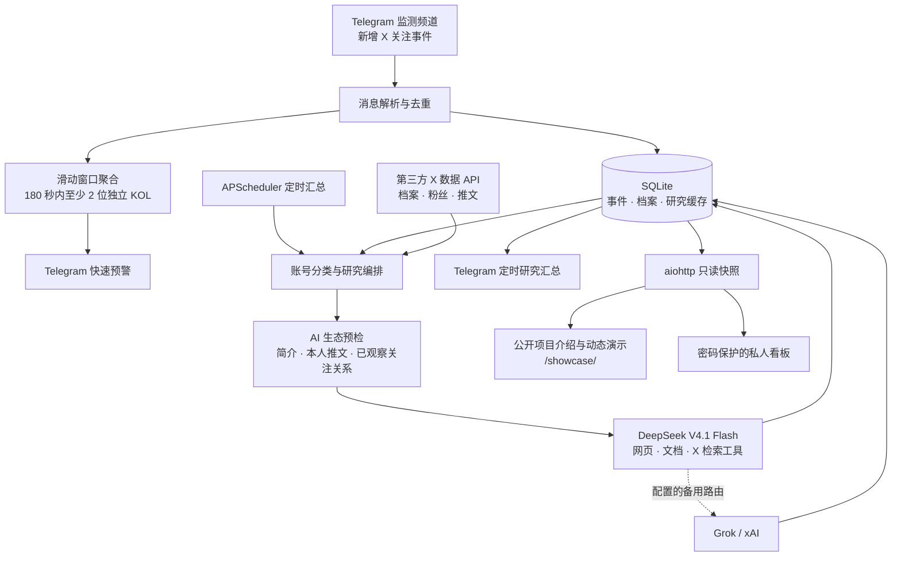

# Alpha Atlas 技术架构

Alpha Atlas 将频道关注事件转成可研究的早期线索，以已保存的数据驱动展示。网页访问与付费研究任务互相独立。

## 数据流

## 模块职责

| 模块 | 职责 |
| --- | --- |
| `src/parser.py` | 解析关注事件，提取账号、关注者及消息中的档案快照 |
| `src/storage.py` | SQLite 表结构、事件去重、窗口聚合、研究缓存和观察状态 |
| `src/bot.py` | Telegram 接入、快速预警、任务调度和消息排版 |
| `src/pipeline.py` | 候选排序、缓存复用、账号研究、降级和汇总编排 |
| `src/chain_preflight.py` | AI 生态预检及原文引用校验 |
| `src/chain_evidence.py` | 链名规范化、来源和生态关系校验、证据合并 |
| `src/deepseek.py` / `src/deepseek_config.py` | Messages 接口、多轮工具调用、研究结果和端点配置 |
| `src/grok.py` | 分类和 Grok / xAI 兼容路由与备用调用 |
| `src/research_tools.py` | 网页、文档、X 检索和资料读取 |
| `src/opentwitter.py` / `src/frontrun.py` | 外部账号资料、粉丝数和 KOL 关注数量补充 |
| `src/alpha_api.py` | 只读快照、公开字段投影、HTTP 服务和健康检查 |
| `src/dashboard_access.py` | 登录、签名会话、来源和 CSRF 校验 |
| `alpha-atlas/web/` / `showcase/` | 私人看板和公开展示站 |

## 信号与研究

快速预警使用同一账号在 180 秒内的独立关注者数量。重复消息不会变成新的独立关注者；接收事件后先做本地判定与通知，较慢的资料补充在后台执行。

定时任务汇总关注变化，查询档案和粉丝数，识别项目方、加密开发者、交易员和其他账号。持续受到关注的“其他”账号会进入项目观察流程。所有符合条件、缺少有效缓存的账号进入研究队列；并发槽限制同时执行数，每轮没有账号数量上限。

生态预检读取已有证据，由 AI 提取生态关系，代码复核来源、原文和关系类型。项目简介或本人推文明示计划上线某链，可以归为该生态；关注链官方的已观察关系仅支持较弱推定。普通 EVM 地址不能确定具体链，投资方、钱包支持资产和转推他人项目也不能视为本项目部署证据。

深研读取官网和文档，在资料不足时搜索项目介绍和公开代币信息；开发者研究关注近期项目、产品和事件。读取失败、资料不足和明确没有找到分别保存，模型文字不能代替已读取来源。CA 和链上部署按实际证据表达，公开简介中的地址不自动等于已完成链上核验。

## 成本与可靠性

- 主模型为 DeepSeek V4.1 Flash，接口名 `deepseek-flash`，经 TeamoRouter 调用；凭据由运行环境注入。
- 项目研究成功缓存通常保留 24 小时，开发者研究缓存通常保留 1 小时；生态预检对成功、未知和失败使用不同有效期。
- 异步并发槽、工具次数预算、请求超时和备用路由控制慢调用与失败。取消每轮账号上限不等于无限同时请求。
- API 使用只读 SQLite 连接和短期响应缓存；展示端每 30 秒轮询快照，访问者不会触发模型、资料抓取或 Telegram 推送。
- 结构化解析和证据校验保留未知、冲突和资料不足状态。

## 访问与部署

公开访问默认关闭，`ALPHA_PUBLIC_ENABLED=1` 才启用 `/showcase/` 和 `/api/public/alpha`。公开快照剔除频道 ID、原始消息、独立关注者身份、密钥及后台配置。公开研究正文仍应只使用可公开材料。

`/login`、私人看板和 `/api/alpha` 保留访问控制；服务 Token 不下发给公开网页。登录采用派生密码哈希、签名会话、HTTPS 安全 Cookie、表单来源和 CSRF 校验。

Docker 将 Bot、API 和网页资源放入同一镜像，Railway 持久卷保存 SQLite。当前使用单实例；多实例需要先处理共享数据库、Bot 消费协调和任务唯一执行。

## 可验证范围

自动化测试覆盖解析、去重、独立关注者阈值、研究队列与缓存、异常降级、生态证据、公开快照和鉴权。单元测试使用合成记录与模拟服务，不证明外部数据永久可用，也不代替研究质量评估。

项目不宣称自动交易、投资收益、全量 X 数据覆盖、链上审计或生产 SLA。
